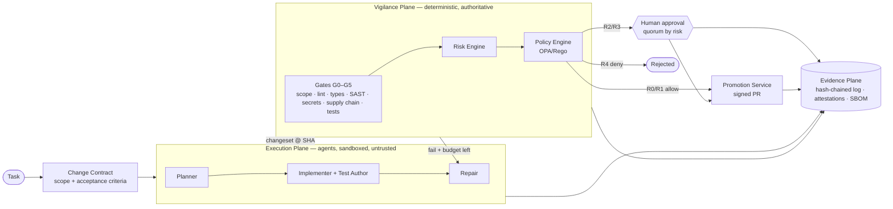

# vigilant-engine

> **Governed multi-agent control plane driving autonomous software delivery, continuous verification, and lifecycle guardrails.**

`vigilant-engine` is a local-first, deterministic execution framework for governing autonomous developer agents across the enterprise Software Development Lifecycle (SDLC). Built on **Python 3.12** and **LangGraph**, it enforces a strict dual-plane architecture: active execution agents run alongside an uncompromised **Vigilance Layer** that performs static policy checks, AST analysis, security scanning, and human-in-the-loop (HITL) approval gating before any code modification hits production branches.

---

## Key Features

* **Dual-Plane Separation:** Decouples creative agent execution (planning, writing code, generating tests) from deterministic governance enforcement.
* **Deterministic Guardrails:** Inline evaluation loops using static analysis, security scanners, and pytest verification suites.
* **Stateful Orchestration:** Explicit, auditable state machine powered by LangGraph with full event-tracing capabilities.
* **MCP & Local Tooling Integration:** Native support for Model Context Protocol (MCP) servers, AST parsers, Git workflows, and CLI environments (`uv`).
* **CI/CD & HITL Approval Gates:** Configurable policy thresholds that automatically trigger manual human reviews for high-risk operations.

---

## Architectural Control Plane Overview

`vigilant-engine` operates on a dual-plane architecture designed to prevent unmonitored agent drift or unverified execution loops.

| Plane | Role | Trust |
|---|---|---|
| **Control** | Orchestrates the lifecycle (LangGraph), budgets, approvals, promotion | Trusted, holds no code-writing logic |
| **Execution** | Planner, Implementer, Test Author, Repair, Critic agents in ephemeral sandboxes | Untrusted — never has push rights |
| **Vigilance** | Deterministic gates, risk scoring, policy-as-code decisions | Authoritative — LLM review can only raise risk |
| **Evidence** | Append-only hash-chained events, signed attestations, evidence bundles, OTel | System of record for audit and replay |

**Core invariants:** separation of duties (agents never promote their own code) · fail closed ·
declared scope per change · least privilege with short-lived capabilities · agents can never edit the
guardrails · every action is evidence · bounded autonomy · deterministic replay.

📐 Full design: [`docs/architecture/ARCHITECTURE.md`](docs/architecture/ARCHITECTURE.md) ·
Decisions: [`docs/adr/`](docs/adr/) ·
Enterprise deployment example: [`docs/engagements/the-hartford/`](docs/engagements/the-hartford/)

---

## Status

Architecture phase (M0 next). See the [roadmap](docs/architecture/ARCHITECTURE.md#19-delivery-roadmap).
