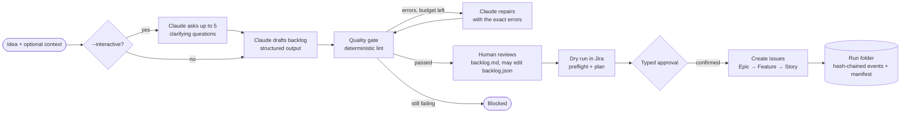

# Idea-to-Jira intake agent

Turns a product idea into a reviewed backlog of **epics → features → stories** and creates
it in Jira. This is the **Intake** stage of the vigilant-engine lifecycle.



## Why it is built this way

The engine's own rules apply to its first agent:

| Rule | How this agent follows it |
|---|---|
| Deterministic authority | Claude drafts. A deterministic quality gate decides whether the backlog can be published. |
| Least privilege | Claude never holds Jira credentials or calls Jira. Code creates the issues from a validated schema. |
| Untrusted by default | The idea text is wrapped in `<idea>` tags and the system prompt treats it as data. |
| Human in the loop | Publishing is a dry run unless `--apply` is given, and `--apply` asks you to type the project key. |
| Bounded autonomy | At most 2 repair rounds; caps on epics, features, stories and issues per run. |
| Everything is evidence | Each run folder has a hash-chained `events.jsonl`; `vigilant intake verify` detects tampering. |

## Quick start

```bash
uv sync

# 1. Plan: needs Claude access (ANTHROPIC_API_KEY, or `ant auth login`)
uv run vigilant intake plan --idea-file examples/ideas/claim-status-updates.md --interactive

# 2. Review runs/<run-id>/backlog.md. Edit runs/<run-id>/backlog.json if you want changes.

# 3. Preview in Jira (writes nothing)
export JIRA_BASE_URL=https://your-site.atlassian.net
export JIRA_EMAIL=you@example.com
export JIRA_API_TOKEN=...          # id.atlassian.com > Security > API tokens
uv run vigilant intake publish --run runs/<run-id> --project CLAIMS

# 4. Create the issues
uv run vigilant intake publish --run runs/<run-id> --project CLAIMS --apply
```

Exit codes: `0` success, `2` blocked by the quality gate or not confirmed, `1` error.

**Backlog written by a person?** `vigilant intake import --backlog-file my-backlog.json`
runs it through the same quality gate, review files and evidence trail, with no model
call. See `examples/backlogs/claim-status-updates.sample.json` for the format.

## What Claude produces

For every story: a user story ("As a … I want … so that …"), at least two given/when/then
acceptance criteria (one for a spike), story points (1, 2, 3, 5, 8 or 13), MoSCoW priority,
kind (`user`, `enabler` or `spike`) and dependencies on other stories. Epics carry the
business outcome, success metrics and MVP flag. Features carry a benefit hypothesis.

The backlog also records **assumptions**, **open questions**, **out of scope** and **risks**,
so gaps in the idea become visible rather than invented. The prompt asks Claude to cover
what ideas often miss: security, privacy and consent, accessibility, auditability, error
states, analytics and operational support.

## Quality gate

| Severity | Rule |
|---|---|
| Error | No epics; empty epic or feature; duplicate or empty refs; user story not in "As a…, I want…, so that…" form; fewer than 2 acceptance criteria (1 for spikes); incomplete given/when/then; unknown, self or circular dependencies; title over 255 characters; size limits exceeded |
| Warning | 13-point stories (split them); no MVP epic; epic without a success metric; title over 120 characters |
| Info | Open questions to resolve before sprint planning |

Errors block `publish`. If you edit `backlog.json`, the gate runs again at publish time,
and the edit is recorded in the event log as a human change.

## Jira setup

| Situation | What to do |
|---|---|
| Your project has a **Feature** issue type between Epic and Story (Jira Premium / Advanced Planning hierarchy) | Nothing. `--feature-mode auto` detects it and links Story → Feature → Epic through the `parent` field. |
| Your project has only **Epic** and **Story** (the default) | `auto` falls back to label mode: stories go under the epic and carry a `feature-<ref>` label and a "Feature:" line. Or pass `--feature-mode label` explicitly. |
| Your issue types have other names | `--epic-type`, `--feature-type`, `--story-type`. |
| Your project has **no Story type**, and Feature sits directly under Epic (common in team-managed projects) | `--story-type Subtask`: stories become sub-tasks of their feature (Epic › Feature › Subtask). Label mode is refused in this case, because a sub-task can't sit directly under an epic. |
| Your project has no story points field | Nothing. Every story's description includes its estimate, priority and kind. |
| You want story points filled in | `--story-points-field customfield_NNNNN`. The ID differs per site; find it under Jira settings > Issues > Custom fields, or ask your Jira admin. |

Every issue gets the labels `ai-generated`, `vigilant-<run-id>` and `moscow-<priority>`.
Stories also get `kind-<kind>`. Add more with `--label`.

**What you approve is what runs.** `--apply` shows the plan, asks for the project key, and
then creates exactly that plan. It does not re-check Jira and re-plan after you confirm.
The approval event records the plan's digest.

**Resuming.** Each created key is written to `jira-manifest.json` straight away. If a run
fails halfway, run the same command again: existing issues are skipped, not duplicated.
A resume keeps the project, issue types and feature mode of the first attempt. If
`backlog.json` changed after a partial publish, the tool refuses to continue.

**Retries never create duplicates.** Rate limits (429) and refused connections are retried,
because Jira did not process those requests. When a create fails in a way where Jira
*might* have saved the issue (a 5xx error, a timeout, or a dropped connection), the tool
does not retry. It marks the issue as uncertain and stops. Run the same command again after
a minute: it searches Jira for issues with the run's label, adopts the issue if it was
created, or creates it if not. If it finds more than one match, it stops and names them so
you can delete the duplicates.

## Run folder

```text
runs/<run-id>/
├── idea.md              the original idea
├── brief.json           idea + context + clarifying answers
├── backlog.json         the backlog (edit here before publishing)
├── backlog.md           review copy for people
├── lint.json            quality-gate findings
├── model-calls.json     model, stop reason, token usage and request ID per call
├── jira-manifest.json   created issue keys (after publish)
└── events.jsonl         hash-chained audit trail
```

## Model and platform

- Default model `claude-opus-5-5`, effort `high` for the backlog and `medium` for clarifying
  questions. Override with `--model` and `--effort`.
- Responses are streamed and constrained to the backlog JSON schema (structured outputs).
- On the Anthropic API, server-side refusal fallback is on (`fallbacks="default"`).
- Amazon Bedrock: `--provider bedrock --aws-region us-east-1` (install the `bedrock`
  extra). Bedrock has no server-side fallback, so a refusal is reported as an error.

## Known limits

- Jira Cloud only. Data Center / Server needs REST v2 and wiki-markup descriptions.
- Dependencies are written into story descriptions, not created as Jira issue links.
  Link-direction semantics vary between sites, so this is left for a later version.
- The Bedrock path is covered by unit tests only. It has not been run against a live
  Bedrock endpoint.
- Planning a large idea takes a few minutes and costs a few dollars of model usage at
  `high` effort. Lower `--effort` or the limits for quick drafts.

## Improving results: standards files and evaluation

**Prompt versions.** `--prompt-version v2` (the default) adds a quality bar learned from
reviewing real runs:
- every promised property has an acceptance criterion that tests it;
- security properties hold across the whole flow;
- limits are numbers with units;
- stories above 5 points are split;
- the MVP starts with a walking-skeleton story;
- cross-cutting quality is recorded in the Definition of Done.

`v1` is kept for comparisons. Prompts live in `src/vigilant_engine/intake/prompts.py`.

**Standards files.** Domain rules belong in a file passed with `--context-file`, so each
team can keep its own rules without changing code:

```bash
uv run vigilant intake plan --idea "..." --context-file standards/security-identity.md
```

`standards/security-identity.md` covers sign-in, recovery and credential flows: owner
notification, cooling-off periods, session revocation, step-skip guards, identical
responses, and breached-password checks. Add more files under `standards/` as needed,
for example payments or claims.

**Quality gate warnings.** Two warnings back the prompt with fixed checks:
- `untested-claim`: a description says encrypted, hashed, notified, audited, masked or
  revoked, but no acceptance criterion tests it.
- `story-too-broad`: a story is over 5 points and its title combines several things.

**Evaluation.** Before trusting a prompt or standards change, compare it on a fixed set of
ideas (`evals/intake/cases.json`). Each case lists expectations a reviewer would demand,
and scoring is deterministic and free. `run` uses Claude and costs roughly a few dollars
per idea.

```bash
# Score a backlog you already have (free)
uv run python evals/intake/run_eval.py score --backlog runs/<id>/backlog.json \
    --case password-reset-sms --label v1-existing

# Plan the cases with each prompt version (costs money; asks first)
uv run python evals/intake/run_eval.py run --prompt-version v1 --label v1
uv run python evals/intake/run_eval.py run --prompt-version v2 --label v2
uv run python evals/intake/run_eval.py run --prompt-version v2 --label v2-standards \
    --context-file standards/security-identity.md

# Compare (free)
uv run python evals/intake/run_eval.py compare evals/results/v1 evals/results/v2
```

Keyword expectations approximate a human review; read the backlogs as well before adopting
a change. Model output varies between runs, so treat a single run per case as a signal, not
proof.

## Robustness and evidence

- **No paid draft is lost.** Each attempt is saved to `runs/<id>/attempts/` as soon as it
  arrives. If a repair fails, or you press Ctrl+C, the drafts so far are kept, and planning
  returns the best one.
- **Best attempt wins.** The result is the attempt with the fewest quality-gate errors, not
  simply the last. A `scope-reduced` warning appears if repairs dropped more than a quarter
  of the stories.
- **Linked dependencies.** Stories are created after the stories they depend on, and
  "Depends on" lists real, clickable Jira keys.
- **Approval anchored in Jira.** Every issue created by a publish carries the hash of the
  approval record. `vigilant intake verify --run <folder> --expect-head <hash>` proves the
  run's log still contains that approval. A truncated or rewritten log fails this check,
  even if its internal chain looks intact.
- **Approval method recorded.** `--yes` requires `--approver`. The log records whether
  approval was typed or flagged, the OS user, and whether the terminal was interactive.
  Local identity is self-asserted; the service deployment takes it from SSO.
- **Context.** See [context guidelines](context-guidelines.md) for writing standards files
  and idea context. `--context-file` can be repeated, standards first.
