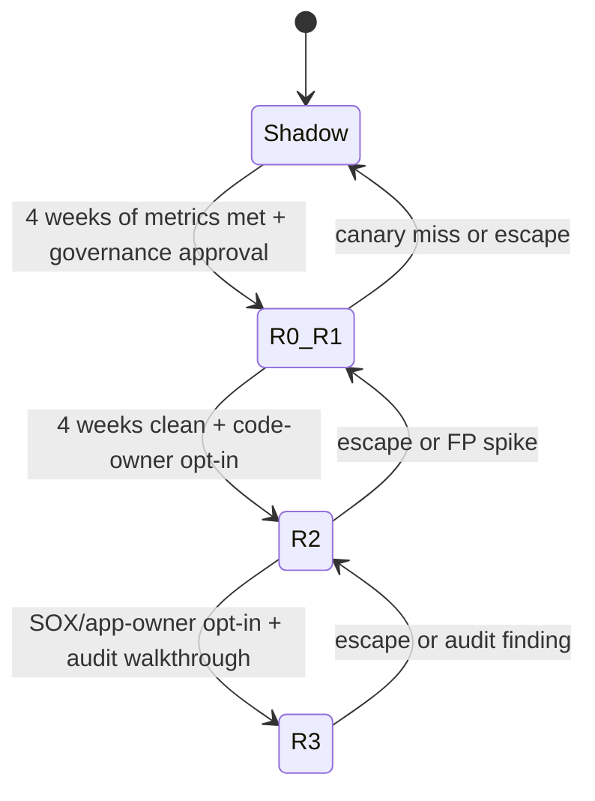

# Rollout Plan

The structure is **shadow first, then earn autonomy**. Every increase in autonomy is gated on
measured evidence, never on calendar dates alone.

## Phase 0: Discovery (weeks 1–3)

| Week | Activities | Outputs |
|---|---|---|
| 1 | Kickoff; stakeholder interviews (platform, InfoSec, AI governance, privacy, internal audit, ITSM, 6–10 app teams); start Bedrock access and TPRM; review the landing zone | Validated assumptions A1–A12; access requests filed |
| 2 | Baseline metrics on candidate repos (vulnerability backlog age, review minutes per PR, lead time, test coverage); pick pilot repos; threat-model workshop | Baseline report; pilot shortlist; threat model v1 |
| 3 | Control-matrix walkthrough with internal audit; AI governance committee review of the risk-tier policy; sign off the architecture | Signed architecture; approved risk map v1; D1–D5 closed |

**Exit gate:** steering-committee go/no-go, InfoSec architecture approval, internal audit
agreement on the evidence format.

## Phase 1: Pilot (weeks 4–11)

| Weeks | Build (pair-built with the platform team) | Use |
|---|---|---|
| 4–5 | Landing-zone accounts, EKS + microVM sandboxes, Aurora, S3 Object Lock, model gateway with Bedrock PrivateLink, event log and hash chain | Internal smoke tests |
| 6–7 | Gate runner with enterprise-scanner adapters + Java/Python packs, risk engine, OPA bundle, CLI approvals, Promotion Service GitHub App | **Shadow mode** on pilot repos: agents produce PRs as *drafts labelled shadow*; humans review but merge their own fixes; we compare |
| 8–9 | Web approval UI (SSO), repo certification job, gate canaries, eval harness, dashboards | Shadow mode continues; tune gate false positives |
| 10–11 | Go-live for **R0/R1** on pilot repos (UC1, UC2) | Live promotion; weekly metrics review |

**Pilot success metrics** (targets set from the Phase 0 baseline):

| Metric | Target |
|---|---|
| Canary block rate | **100%** (any miss halts autonomy) |
| Escape rate (agent changes reverted or linked to incidents) | ≤ the human baseline for comparable changes |
| PR acceptance rate (merged without rework) | Set from the shadow-mode results |
| Reviewer minutes per merged change | Reduced against baseline |
| Vulnerability remediation lead time on pilot repos | Reduced against baseline |
| Cost per accepted change | Tracked; below the agreed ceiling |
| Gate false-positive rate | Under the agreed threshold after tuning |

**Exit gate:** metrics met for 4 consecutive weeks, internal audit sample walkthrough passed, and
AI governance approval to enable R2/R3.

## Phase 2: Controlled production (weeks 12–20)

- Enable R2/R3 routing with the ServiceNow integration (standard and normal change models).
- Onboard the first **SOX-scoped** application with the SOX app-owner approval path.
- Roll out Claude Code under managed settings to pilot teams (MDM or server-managed settings), with OTel to the SIEM.
- UC5 legacy comprehension (read-only) on one legacy system.
- First quarterly control-effectiveness report.

**Exit gate:** quarterly report accepted by internal audit; zero canary escapes; first SOX-app
changes pass an audit sample.

## Phase 3: Scale (week 21 onward)

- Self-service repo onboarding (certification job + risk-map PR template) for every business unit.
- UC4 state regulatory changes with compliance approvers; UC6 claims and billing.
- Capacity scaling, per-business-unit budgets and chargeback.
- **FDE exit criteria:** the customer platform team has shipped 2 engine releases, handled 1 incident, and run 1 model upgrade through the governed path without FDE help.

## Autonomy ratchet

Autonomy moves up one notch at a time per repo, and it moves **down automatically**:

