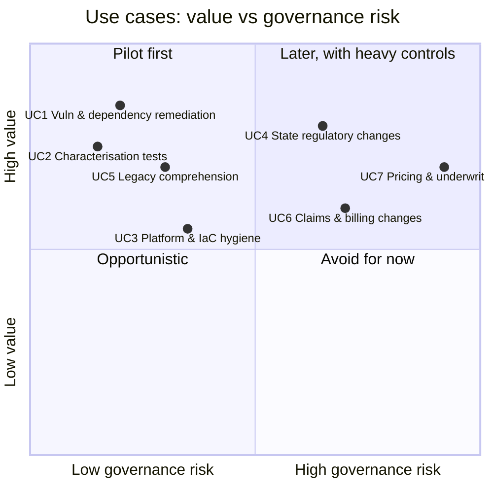
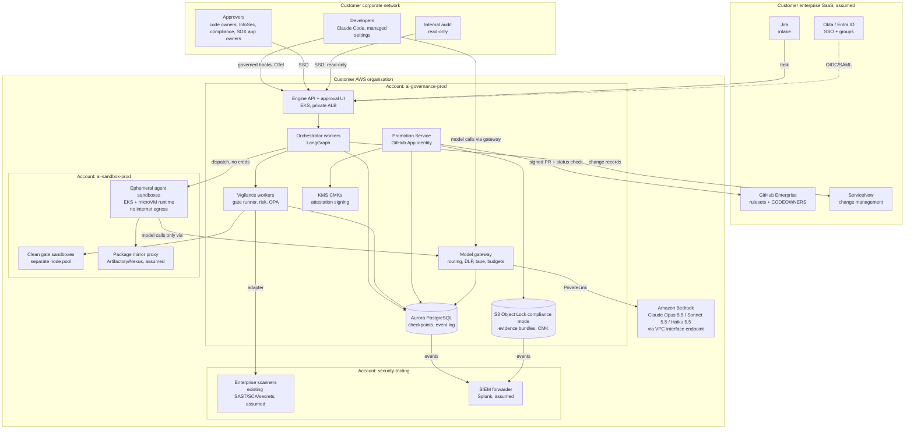

# vigilant-engine @ The Hartford — Solution Architecture

| | |
|---|---|
| **Document type** | Forward-deployed engineering (FDE) solution architecture — customer deployment of the [reference architecture](../../architecture/ARCHITECTURE.md) |
| **Status** | Draft v0.1 for discovery workshops |
| **Customer** | The Hartford — commercial lines, personal lines, group benefits |
| **Prepared by** | FDE team (Anthropic) with the customer's platform engineering, InfoSec, AI governance, and internal audit stakeholders |
| **Companion docs** | [Control matrix](CONTROL-MATRIX.md) · [Rollout plan](ROLLOUT-PLAN.md) · [Reference configs](reference-configs/) · ADRs [0006](../../adr/0006-model-access-bedrock-privatelink.md)–[0010](../../adr/0010-pricing-underwriting-code-excluded.md) |

> **Read this first.** This is a design exercise built only from public information about the
> customer and Anthropic's published platform documentation. It is **not** an official document of
> The Hartford or of Anthropic. Every statement about the customer's internal environment (cloud,
> tools, org structure, data classes) is an **assumption** listed in [§18](#18-assumptions-register)
> and must be validated in discovery before anything is built. Regulatory content summarises public
> rules for design purposes and is not legal advice. Hartford Legal and Compliance must confirm how it applies.

---

## 1. Executive summary

**Problem.** A large, multi-line US insurer runs a big portfolio of applications: policy
administration, rating, claims, billing, agent/broker portals, group-benefits absence and disability
platforms, and decades of legacy code. Much of the engineering effort is not differentiating:

- clearing vulnerability and dependency backlogs,
- writing missing tests before modernisation,
- making state-by-state regulatory updates,
- keeping up with platform upgrades.

AI coding agents can absorb much of this work. A regulated, SOX-scoped, NYDFS-supervised insurer
cannot let them do it without auditable change control.

**Solution.** Deploy `vigilant-engine` inside the customer's own cloud boundary as the governed
control plane for every AI-authored code change. Every change works the same way, whether an
autonomous agent or a developer using Claude Code produced it:

- It runs in an isolated sandbox inside the customer account.
- It is checked by the customer's **existing** security scanners plus insurance-specific policy gates.
- It is routed to humans **in proportion to risk**, with SOX-scoped apps going through ServiceNow change management.
- It produces a tamper-evident evidence bundle that internal audit can sample directly.

**What the first 90 days prove** (detail in [ROLLOUT-PLAN.md](ROLLOUT-PLAN.md)):

1. Agents clear a real vulnerability/dependency backlog on 3–5 non-SOX services, running first in shadow mode and then promoting low-risk changes (R0/R1).
2. **Zero** guardrail escapes in scheduled canary tests. Every seeded secret, injection, test deletion, or protected-path edit is blocked.
3. Internal audit accepts the evidence bundle and population report as sufficient for change-management testing.
4. Reviewer time per merged change and time-to-remediate fall against a baseline measured in discovery.

**Decisions we need from the customer early** (§17): the model access path (Bedrock via
PrivateLink is recommended), pilot repositories, data-classification rules for AI use, the
ServiceNow change model, and the AI governance committee's sign-off on the risk-tier policy.

## 2. Business context and why it matters here

| Customer reality (public) | Engineering implication | How the design responds |
|---|---|---|
| Multi-line insurer (commercial, personal, group benefits) with many distinct platforms | Heterogeneous stack (assumed: Java/.NET services, Python analytics, JS front ends, IaC, mainframe legacy) | Language-pluggable gate packs; per-business-unit risk maps |
| Publicly traded, so SOX 404 applies to financially significant applications | Change management, SoD, and access controls are audited | Maker ≠ checker by construction; evidence bundles; population reports for audit sampling |
| Licensed in New York and many other states | NYDFS 23 NYCRR 500 cybersecurity duties; NAIC-model data-security laws in many states | Access, audit-trail, app-security, and third-party controls mapped in the [control matrix](CONTROL-MATRIX.md) |
| Uses AI in insurance decisions (industry-wide) | NAIC AI Model Bulletin, NYDFS Circular Letter No. 7 (2024), Colorado SB21-169: governance and fairness duties for AI systems used in underwriting, pricing, and claims | Code that implements pricing, underwriting, or claims decisioning is **excluded from agent autonomy** at launch ([ADR-0010](../../adr/0010-pricing-underwriting-code-excluded.md)) |
| Holds large volumes of nonpublic personal information (NPI) and, in group benefits, health-related claim data | Repos, fixtures, and logs can contain sensitive data | Repo onboarding certification, data-class routing, DLP at the model gateway, no production data in sandboxes |
| State-by-state product variation (forms, rules, rates filed with regulators) | High-volume, repetitive, regulator-visible change | Phase 2 use case with compliance approval in the loop (R3) |

## 3. Engagement model

### 3.1 Team and RACI

| Role | Who | Responsibilities |
|---|---|---|
| Executive sponsor | Customer CIO/CTO organisation | Scope, funding, escalation; chairs the steering committee |
| Platform owner | Customer platform/developer-experience engineering | Owns the engine in production; on-call after hand-over |
| InfoSec architect | Customer CISO organisation | Approves the threat model, gate packs, network design, and third-party risk review of Anthropic |
| AI governance / model risk | Customer AI governance committee and enterprise risk | Approves the risk-tier policy, model inventory entries, excluded domains, and model upgrades |
| Privacy | Customer privacy office | Data classification for AI use and DLP rules |
| Internal audit (advisory) | Customer internal audit | Confirms evidence sufficiency **before** go-live, not after |
| ITSM owner | Customer change management (ServiceNow) | Standard-change templates and CAB integration |
| Pilot app teams | 3–5 teams | Supply repos and CODEOWNERS; review agent PRs; give feedback |
| **Anthropic FDE** | 1–2 forward-deployed engineers | Architecture, build alongside the platform team, Claude integration, evals, knowledge transfer |
| Anthropic account / applied AI | Account team | Commercial terms, data-retention configuration, model roadmap, escalations |

### 3.2 Operating cadence

- **Daily** stand-up with the platform team; **weekly** working session with InfoSec, AI governance, and audit; **bi-weekly** steering committee.
- **Build with, not for.** Every component is pair-built with customer engineers. The exit criterion for the FDE phase is that the customer team runs the engine, releases it, and handles incidents unaided.

## 4. Use-case portfolio

Ranked by value against governance risk. The pilot takes the top-left quadrant: high value,
deterministic verification, low regulatory sensitivity.

| ID | Use case | Phase | Default tier | Why |
|---|---|---|---|---|
| UC1 | **Vulnerability and dependency remediation**: SCA/SAST findings, framework upgrades | Pilot | R1–R2 | Large backlog; NYDFS 500 vulnerability-management pressure; verification is mostly deterministic |
| UC2 | **Characterisation and unit tests** for under-tested services | Pilot | R0 | Lowers the risk of every later change; test-only changes are low risk |
| UC3 | Platform tooling, CI hygiene, IaC lint fixes (non-prod) | Pilot | R1–R2 | Internal blast radius; IaC scanners give a strong signal |
| UC5 | **Legacy comprehension**: generate documentation, dependency maps, and characterisation tests for mainframe and legacy services (read-only on source) | Phase 2 | R0 | Unlocks modernisation without changing legacy code |
| UC4 | State-specific regulatory changes (form logic, rule tables, notices) | Phase 2–3 | R3 | Regulator-visible; needs a compliance approver; filed artefacts must match filings |
| UC6 | Claims, billing, and payment code | Phase 3 | R3 | Financial impact; PCI scope for payments |
| UC7 | **Pricing, rating, underwriting, and claims-decisioning logic** | Excluded | R4 | AI-governance and unfair-discrimination obligations; needs model-risk processes beyond code review ([ADR-0010](../../adr/0010-pricing-underwriting-code-excluded.md)) |

## 5. Target deployment architecture

Assumption A1: AWS is the primary cloud. If discovery shows Azure or GCP, the same structure maps
to Microsoft Foundry or Vertex AI. Only the model-gateway adapter and infrastructure modules change.

**Design notes**

- **Account separation** is the physical form of the plane separation. Sandboxes run in their own
  AWS account with no IAM permissions besides pulling images. They cannot reach Bedrock, GitHub,
  the database, or the internet directly. Their only channels are the model gateway (for model
  calls) and the orchestrator's work queue.
- **Two sandbox pools.** Agent sandboxes are untrusted. Gate sandboxes are clean, rebuilt from the
  commit SHA, and have no shared volumes with agent pools.
- **MicroVM isolation.** Agents run arbitrary build and test commands, so sandboxes use a
  microVM-class runtime (for example Firecracker via Kata Containers, or gVisor) rather than plain
  containers. Each sandbox gets CPU, memory, and disk quotas and a hard wall-clock limit.
- **Package egress** goes only through the customer's existing artifact proxy. That gives one
  allow-list, one audit trail, and malware screening reused from the existing supply-chain program.
- **Reuse, don't duplicate.** The Vigilance plane calls the customer's **existing** enterprise
  SAST/SCA/secrets scanners through adapters, so findings match InfoSec's system of record. Open-source
  scanners run only where no enterprise tool covers a language.
- **The engine is never on the production critical path.** If it is down, humans keep shipping
  through the normal SDLC, and only AI-authored promotion stops. The design fails closed for agents
  and stays open for people.

## 6. Identity, access, and segregation of duties

| Principal | Authenticates via | Can | Cannot |
|---|---|---|---|
| Developer (requester) | IdP SSO | Submit tasks, view own runs, run Claude Code under managed settings | Approve their own run; change policies |
| Code owner / approver | IdP SSO, group from CODEOWNERS sync | Approve R2/R3 within their ownership | Approve runs they requested |
| InfoSec approver | IdP SSO, `ai-gov-security-approvers` group | Second approver on R3; tune gate severities through PR to the policy repo | Bypass gates in the engine |
| SOX app owner | IdP SSO, group from the SOX application inventory | Approve R3 in SOX-scoped apps; linked to the ServiceNow CHG | — |
| Platform admin | IdP SSO + MFA + PAM session | Operate the engine (deploy, scale, rotate keys) | **Approve changes or edit policies.** Admin ≠ approver ≠ policy author (classic ITGC SoD) |
| Policy author | Git PR to the separate `ai-governance-policies` repo | Propose policy and risk-map changes | Merge without an AI-governance and InfoSec review (two-person rule) |
| Auditor | IdP SSO, read-only role | Read evidence, export populations | Change anything |
| Orchestrator workload | IRSA role | Enqueue work, write events | Push to Git; call Bedrock directly |
| Agent sandbox | None (no cloud identity) | Call the model gateway with a short-lived, run-scoped token | Anything else |
| Model gateway | IRSA role | `bedrock:InvokeModel*` on approved model ARNs only | Other AWS APIs |
| Promotion Service | GitHub App installation token (key in Secrets Manager, CMK-encrypted) + KMS signing key | Create branches and PRs, set the `vigilant/decision` status | Merge to protected branches unless the policy tier allows it and branch rules agree |

**Break-glass.** If the engine has an incident, nobody uses an "override" button. Teams fall back
to the normal human SDLC. No engine-side bypass exists, which removes a whole class of audit findings.

## 7. Data protection

### 7.1 Classification-driven routing

Assumption A6: four data classes (Public, Internal, Confidential, Restricted). The policy is owned by
Privacy and InfoSec and enforced by the model gateway and repo onboarding.

| Repo or data class | Agent autonomy | Model access | Logging of model I/O |
|---|---|---|---|
| Public / Internal | Full lifecycle (R0–R3 per risk map) | Bedrock (in-account) | Full content in the evidence store (CMK) |
| Confidential | Full lifecycle after repo certification | Bedrock (in-account) | Full content, restricted access group |
| Restricted (NPI/PHI-bearing systems) | Phase 3 only, after a privacy impact assessment | Bedrock (in-account); Covered Models excluded | Hashes and metadata by default; content only if Privacy approves |

### 7.2 Repository onboarding certification

Before agents may work in a repository, a one-time **onboarding run** (deterministic, no model)
must pass. The result is stored as evidence.

1. Run a secrets scan across the full history, not just HEAD.
2. Run a PII/PHI/NPI scan of fixtures, test data, SQL dumps, and sample payloads. Synthetic data must replace real customer data before onboarding.
3. Look up the repo in the SOX application inventory and CMDB to get its SOX flag, business unit, and data class.
4. Check that CODEOWNERS is present and resolves to active groups.
5. Check that branch rulesets require the `vigilant/decision` status check and reviews.
6. Check that the risk-map entries for sensitive paths have been confirmed by the app owner.

### 7.3 Controls in the model path

- **DLP at the model gateway:** pattern and entropy detectors for secrets, SSNs, policy and claim
  number formats (customer-specific patterns, to be defined), and bank and card numbers. The gateway
  redacts on egress and logs a `dlp.redaction` event. If a redaction count exceeds the threshold,
  the run aborts and escalates.
- **No production data** enters sandboxes. They have no network route to production data stores
  (enforced by the account boundary and network policy).
- **Retention:** evidence bundles go to S3 Object Lock in compliance mode for the period set by
  the customer's records-retention schedule. SOX change evidence typically needs multi-year
  retention; Records Management confirms the exact period.
- **Model-provider retention:** with Bedrock, prompts and completions stay inside the customer's
  cloud-provider environment under AWS's Bedrock data terms. If the Anthropic-operated API is used
  later (§8.1), request zero data retention (ZDR) for regulated workspaces. **Covered Models (the
  Claude Fable / Mythos family) require 30-day retention and are not available under ZDR**, so they
  are excluded from Restricted workloads by policy.

## 8. Claude integration architecture

### 8.1 Model access path

| Criterion | Amazon Bedrock (recommended default) | Claude Platform on AWS | Claude API (first-party) |
|---|---|---|---|
| Operator | AWS (partner-operated) | Anthropic, through AWS (SigV4, IAM, Marketplace billing) | Anthropic |
| Private connectivity / stays in the customer's cloud boundary | **Yes**: VPC interface endpoint; data handled under Bedrock terms in the customer's provider environment | AWS endpoint, operated by Anthropic | Public endpoint |
| Feature parity with the Anthropic API | Subset | Same-day parity | Full |
| Message Batches (cheap eval runs) | No (Anthropic Batches API) | Yes | Yes |
| Server-side refusal `fallbacks` | No: use the SDK's client-side fallback middleware | Yes | Yes |
| `inference_geo` (US-only inference) | No (use regional or US cross-region inference profiles) | Yes | Yes |
| Managed Agents | No | Beta | Beta |
| Fits procurement and TPRM | Usually already approved as an AWS service | AWS Marketplace | New vendor onboarding |

**Recommendation ([ADR-0006](../../adr/0006-model-access-bedrock-privatelink.md)):** use Bedrock
through PrivateLink for all agent and Claude Code traffic. It is the shortest path through InfoSec
and third-party risk management, and the data-boundary story is the simplest. The model gateway
abstracts the provider, so a later move to Claude Platform on AWS (for Batches-based evals or
newer features) is a configuration change with its own ADR, not a re-architecture.

### 8.2 Agent runtime: self-hosted, not Managed Agents

Every agent loop runs **inside the customer's sandbox account**
([ADR-0007](../../adr/0007-self-hosted-agent-runtime.md)):

| Agent | Runtime | Why |
|---|---|---|
| Implementer, Test Author, Repair | **Claude Agent SDK** (`claude-agent-sdk`, Python) inside the sandbox, `cwd` = the run's worktree, `setting_sources=[]` so repo-supplied settings are ignored | Batteries-included coding agent (file tools, Bash, subagents) with hooks that bind every tool call to the governance plane |
| Planner, Critic | **Messages API** with structured outputs (`output_config.format`) for `Plan` and `Finding[]` schemas; read-only tools | No filesystem write needed; schema-valid output feeds deterministic gates |
| Untrusted-content quarantine | Messages API, low effort, small model | Summarises issue text and tool output into typed fields before privileged steps see them |

Managed Agents is not used for this workload. On Bedrock it is not available. It is also not
eligible for ZDR or HIPAA, and the customer's requirement is that code and agent execution stay
inside its own boundary.

**Governance hooks in the Agent SDK.** Every SDK session is created with a `PreToolUse`
`HookMatcher` that sends each tool call to the engine's MCP and tool gateway. The gateway checks
the run's capability token, path scope, and command allow-list, then returns `allow` or `deny`
through `permissionDecision`. `PostToolUse` hooks emit evidence events. `disallowed_tools` carries
scoped deny rules (for example `Bash(git push *)`), which hold even in bypass mode. In-process
rules are **defence in depth only**. The documentation itself notes that command-pattern rules are
not a security boundary. The real boundaries are the sandbox (no credentials, no egress) and the
independent gate run.

### 8.3 Model routing (pinned; changes are governed)

| Role | Model | Effort | Notes |
|---|---|---|---|
| Planner | `claude-opus-5-5` | `high` | Hardest reasoning: scope, decomposition, risk notes |
| Implementer | `claude-opus-5-5` | `medium`, tuned by eval | Measure first. Use a smaller model only if evals show quality holds at lower cost per *accepted* change |
| Test Author | `claude-sonnet-5-5` | `medium` | High volume; tests are verified by mutation and coverage gates |
| Repair | `claude-sonnet-5-5` | `medium` | Short, structured loops |
| Critic (advisory) | `claude-opus-5-5` | `high` | Separate session and prompt from the Implementer, and given only the diff, contract, and gate results, which keeps its review independent |
| Quarantine / classifiers | `claude-haiku-5-5` | `low` | Intake classification, untrusted-content summarisation |
| Claude Code (developers) | Opus 5.5 default, Sonnet 5.5 and Haiku 5.5 pinned via `ANTHROPIC_DEFAULT_*_MODEL` | — | Same Bedrock endpoint through the gateway |

**API conventions the engineering team must know** (current model behaviour):

- Opus 5.5 always uses adaptive thinking (`thinking: {type: "disabled"}` returns a 400). Control
  depth and cost with `output_config.effort`, and set it explicitly because the default is `medium`.
- Forced `tool_choice` (`any` / `tool`) returns a 400 on Opus 5.5 and Sonnet 5.5. Use `auto` with
  `strict: true` tools, or structured outputs.
- Handle `stop_reason: "refusal"` before reading content. On Bedrock, use the SDK's client-side
  refusal-fallback middleware, and log each fallback as an evidence event because the serving model
  changed.
- **Prompt caching:** keep stable content first (tools → system prompt → repo map → contract),
  with volatile content after the last breakpoint. The repo map and policy excerpts are reused
  across every step of a run, so caching is the biggest cost lever. Check
  `usage.cache_read_input_tokens` in the tape.
- Task budgets are not offered on Bedrock. The engine's Budget Manager enforces iteration, token,
  and cost ceilings itself (invariant I9).
- Use streaming for long agent turns and large `max_tokens`.
- **Model pinning and upgrades.** Model IDs are pinned in `model-routing.yaml`, a governed policy
  file. A model upgrade is itself a change that has to clear the agent eval suite, canary suite,
  and red-team suite, and get AI-governance approval. It is recorded in the model inventory, as the
  NAIC AI bulletin's governance expectations call for.

See [`reference-configs/model-routing.yaml`](reference-configs/model-routing.yaml).

### 8.4 One governance plane for Claude Code and autonomous agents

Developers will use Claude Code interactively long before autonomous agents reach scale. The same
control plane governs both ([ADR-0008](../../adr/0008-unified-governance-claude-code.md)):

| Layer | Mechanism | Enforced by |
|---|---|---|
| Client policy | `managed-settings.json` pushed by MDM to `/Library/Application Support/ClaudeCode/` (macOS), `/etc/claude-code/` (Linux), and `C:\Program Files\ClaudeCode\` (Windows); `allowManagedPermissionRulesOnly`, `allowManagedHooksOnly`, `disableBypassPermissionsMode: "disable"`, deny rules for guardrail paths and `git push` to protected branches | Endpoint management |
| Client telemetry | `CLAUDE_CODE_ENABLE_TELEMETRY=1`, OTLP to the customer's collector → SIEM; metrics such as `claude_code.cost.usage`, `claude_code.token.usage`, `claude_code.commit.count` | Endpoint + SIEM |
| Client → evidence | `PostToolUse` / `Stop` hooks post session metadata to the engine API, which links developer sessions to the commits they produce | Engine |
| Model path | `CLAUDE_CODE_USE_BEDROCK=1` with the base URL pointed at the model gateway; model IDs pinned | Gateway |
| **Authoritative control** | AI-assisted commits are labelled with a commit trailer. PRs from AI-assisted branches must pass the same Vigilance gates and `vigilant/decision` check, enforced by **GitHub rulesets**, not by the client | Server side |

Client-side settings are a guardrail for usability, not a control the customer relies on for SOX.
The control that counts runs on the server, so a developer who edits their local config still
cannot get an ungoverned change merged.

See [`reference-configs/claude-code-managed-settings.json`](reference-configs/claude-code-managed-settings.json).

## 9. Vigilance plane: insurer gate packs

### 9.1 Language packs (adapters to existing tools first)

| Stack (assumed) | Hygiene | Security (prefer the enterprise tool) | Correctness |
|---|---|---|---|
| Java / Spring | Checkstyle, PMD, compiler `-Werror` profile | Enterprise SAST + SCA; SpotBugs + FindSecBugs as fallback | JUnit, JaCoCo changed-line coverage, PIT mutation on critical packages |
| .NET | Roslyn analyzers, `dotnet format --verify-no-changes` | Enterprise SAST + SCA; security analyzers as fallback | `dotnet test`, coverlet coverage |
| Python | ruff, mypy | Enterprise SAST; Semgrep, Bandit, pip-audit as fallback | pytest, coverage.py, Hypothesis |
| TypeScript / JS | eslint, `tsc --noEmit` | Enterprise SAST + SCA; osv-scanner as fallback | jest/vitest, coverage |
| IaC (Terraform/CloudFormation) | `terraform fmt/validate`, cfn-lint | Checkov or the customer's CNAPP policy; no public buckets, encryption, tagging | `terraform plan` in sandbox against a mocked provider; policy tests |
| Mainframe (COBOL/PL/I) | — | — | **Read-only in phases 1–2.** Agents produce documentation and characterisation tests only; no source changes |

### 9.2 Insurance-specific policy gates

These go beyond generic scanners and are owned jointly by InfoSec, Privacy, and AI governance:

| Gate | What it detects | Default action |
|---|---|---|
| **Protected-attribute use** | New references to protected-class attributes (race, religion, national origin, sex, etc.) or known proxies, in any module tagged `decisioning` | Deny (R4) + notify AI governance |
| **Decisioning-logic change** | Diffs touching rating tables, rating algorithms, underwriting rules, claims-triage or fraud-scoring logic (path and annotation map) | Deny for agents (R4), per ADR-0010 |
| **Sensitive-data logging** | Logging or serialising fields tagged NPI/PHI (SSN, DOB, medical, bank account), or new log statements in classified modules | Block |
| **New data egress** | New outbound HTTP clients, hosts, queues, or file exports in services tagged Confidential+ | Raise to R3 + InfoSec approver |
| **Filed-artefact integrity** | Changes to form templates or state rule tables tied to regulatory filings | R3 + compliance approver; needs the filing reference in the contract |
| **Payments scope** | Changes in PCI-scoped repos or paths | R3 + InfoSec + app owner |
| **Test-integrity** | Deleted, skipped, or weakened tests; new suppressions (`@SuppressWarnings`, `// NOSONAR`, `# nosec`, …) | Risk uplift + mandatory human review |

## 10. Risk tiers and approval routing (customer policy)

The tier logic is the reference model. Customer specifics live in
[`reference-configs/risk-map.yaml`](reference-configs/risk-map.yaml) and the policy bundle.

| Tier | Example at the customer | Engine approval | ServiceNow | GitHub |
|---|---|---|---|---|
| R0 | Tests only, docs, characterisation tests | None | Pre-approved **standard change**, auto-created and closed with an evidence link | 1 human review (normal team rule) |
| R1 | Patch-level dependency bump, SAST fix in a non-SOX service | None | Standard change | 1 human review |
| R2 | Minor/major framework upgrade; non-SOX service logic; IaC in non-prod | 1 code owner | Normal change (low risk), engine approval attached | Code-owner review |
| R3 | Any SOX-scoped app; claims/billing/payments; filed forms; new data egress | Code owner **+** InfoSec, compliance, or SOX app owner (per rule) | Normal change → CAB or delegated approver, per the customer's change policy | Code owner + required second review |
| R4 | Guardrails, CI/CD, policies, pricing/underwriting/decisioning logic, protected-attribute use | **Denied for agents** | — | — |

**Approval records sync both ways.** The engine's signed approval is the *decision record*.
ServiceNow is the *ITSM record*. The CHG holds the evidence-bundle digest and link, and the engine
holds the CHG number. Deployment stays in the customer's existing pipelines and change windows
([ADR-0009](../../adr/0009-servicenow-and-enterprise-scanner-integration.md)).

## 11. Audit and evidence: designed for how auditors test

Internal and external auditors test change management by **sampling from a population**, then
inspecting each sample for authorisation, testing, approval, and SoD. The engine produces all of
these directly:

| Auditor need | Engine output |
|---|---|
| Complete population of AI-authored changes in the period | `vigilant audit population --from --to --app`: signed CSV/JSON export reconciled to Git merge history (completeness check) |
| Per-sample evidence | Evidence bundle: contract, plan, diff, gate reports (SARIF), SBOM, risk breakdown, approvals with identities and timestamps, CHG link, attestation |
| SoD proof | The bundle shows requester ≠ approver ≠ promoter identity; the platform-admin role is excluded from the approver groups (export of IdP group membership at period end) |
| Control operating effectiveness | Monthly **gate-canary report**: seeded violations and block rate, which must be 100% |
| Integrity of evidence | Hash-chain verification report plus S3 Object Lock configuration evidence |
| Change to the control itself | The policy-repo PR history shows who changed thresholds, with two-person approval |

## 12. Observability and operations

- **SIEM:** engine events, gateway DLP events, sandbox runtime events, and Claude Code OTel all go
  to the customer's SIEM. Detection rules alert on gate-error spikes, DLP redaction spikes, denied
  tool calls per run, repeated approval rejections, and any policy-bundle signature failure.
- **SLOs** (proposed): engine API availability 99.5% in business hours; p50 time from task to PR
  under 30 minutes for R0/R1; approval notification under 1 minute; evidence write durability at
  RPO 0 (promotion blocks until the bundle is committed).
- **FinOps:** per-business-unit and per-repo budgets in the gateway; cost per *accepted* change as
  the primary efficiency metric; chargeback through AWS cost-allocation tags and gateway metering.
- **Runbooks:** gate tool outage, Bedrock throttling or outage (runs pause, checkpoints persist),
  model refusal spikes, sandbox escape suspicion (kill the pool, rotate the gateway signing key,
  preserve evidence), and evidence-store integrity alarms.

## 13. Security: customer-specific threat additions

These add to reference architecture §10:

| Threat | Customer-specific control |
|---|---|
| Agent introduces discriminatory logic into decisioning code | Decisioning paths are R4; the protected-attribute gate; AI-governance notification |
| Agent leaks NPI/PHI into prompts, logs, or PR text | Repo certification, gateway DLP, PR-description scanning before promotion |
| Poisoned issue or ticket text drives the agent (prompt injection via Jira) | Quarantine summariser (Haiku) turns ticket text into typed fields; the privileged agent never sees raw ticket text |
| Third-party/vendor code in the repo carries license or malware risk | Artifact-proxy screening + SCA licence policy gate |
| Insider uses the agent to launder an unauthorised change | Requester ≠ approver; the contract records intent; scope gate; full attribution in evidence |
| Model-provider compromise or behaviour drift | Pinned models, a governed upgrade path, canary and red-team runs on every model or prompt change; deterministic gates stay authoritative |

## 14. Non-functional requirements

| Area | Requirement |
|---|---|
| Scale (pilot → scale) | 20 → 300 concurrent sandboxes; horizontal workers; per-tenant quotas |
| Availability | Not on the production path; degraded mode = human SDLC |
| DR | Aurora multi-AZ with cross-region snapshots; S3 cross-region replication with Object Lock; RTO 8h / RPO 15m for orchestration state; RPO 0 for promoted-change evidence |
| Security | CIS-hardened images; signed container images; no long-lived credentials; quarterly pen test; annual red-team |
| Privacy | PIA completed before any Confidential or Restricted onboarding |
| Accessibility | Approval UI meets WCAG 2.1 AA |

## 15. Delivery plan (summary)

| Phase | Weeks | Scope | Exit gate |
|---|---|---|---|
| 0 Discovery | 1–3 | Validate assumptions, baseline metrics, pick pilot repos, threat model, control-matrix walkthrough with internal audit | Steering-committee go; InfoSec architecture approval |
| 1 Pilot (shadow → live R0/R1) | 4–11 | UC1, UC2 on 3–5 non-SOX repos; Bedrock, sandboxes, gates, evidence, CLI and web approvals | Zero canary escapes; audit walkthrough passed; target metrics met |
| 2 Controlled production | 12–20 | R2/R3, ServiceNow, first SOX-scoped app, Claude Code managed rollout to pilot teams, UC5 | First quarterly control-effectiveness report accepted |
| 3 Scale | 21+ | Business units onboard through self-service repo certification; UC4/UC6 with compliance | Platform team runs independently; FDE exit |

Full detail is in [ROLLOUT-PLAN.md](ROLLOUT-PLAN.md).

## 16. Risk register (engagement)

| Risk | Likelihood | Impact | Mitigation |
|---|---|---|---|
| InfoSec or TPRM review delays model access | Medium | High | Start the Bedrock path in week 1; Anthropic trust documentation (SOC 2 Type II, ISO certifications) shared through the trust portal |
| Developers distrust agent PRs | Medium | Medium | Shadow mode first; publish acceptance metrics; teams choose their own pilot backlog |
| Gate false positives cause friction | High | Medium | Tune per repo in shadow mode; track gate FP rate as an SLO |
| Audit rejects evidence late | Low | High | Internal audit in discovery; sample walkthrough before go-live |
| Cost overrun | Medium | Medium | Gateway budgets; cost per accepted change reviewed weekly; caching from day 1 |
| Scope creep into decisioning code | Medium | High | ADR-0010 exclusion enforced in policy, not process |
| Legacy toolchains (mainframe) cannot run in sandboxes | High | Low | Phase 1–2 read-only for mainframe; revisit with the customer's mainframe DevOps toolchain |

## 17. Decisions requested from the customer

| # | Decision | Recommendation | Needed by |
|---|---|---|---|
| D1 | Model access path | Bedrock via PrivateLink (ADR-0006) | Week 1 |
| D2 | Pilot repositories (3–5, non-SOX, Java or Python, active vulnerability backlog) | Platform-team nomination | Week 2 |
| D3 | Data classes eligible for AI use in the pilot | Public, Internal, Confidential | Week 2 |
| D4 | ServiceNow model for AI changes | Standard change for R0/R1; normal change for R2+ | Week 4 |
| D5 | Risk-tier policy and excluded domains | Adopt [risk-map.yaml](reference-configs/risk-map.yaml) as the starting point | Week 3 (AI governance committee) |
| D6 | Claude Code rollout scope | Pilot teams only in Phase 2 | Week 8 |
| D7 | Evidence retention period | Per the records schedule | Week 3 |

## 18. Assumptions register

Each item must be validated in discovery. Mark it ✅ or update the design.

| ID | Assumption | Design impact if wrong |
|---|---|---|
| A1 | AWS is the primary cloud with an established multi-account landing zone | Swap to the Foundry/Vertex adapter and IaC modules |
| A2 | GitHub Enterprise is the SCM, with rulesets available | GitLab/Bitbucket adapter; equivalent push rules |
| A3 | ServiceNow is the ITSM / change-management system | ITSM adapter |
| A4 | Okta or Entra ID is the IdP with group-based RBAC | IdP adapter |
| A5 | Enterprise SAST/SCA/secrets tools exist with APIs or CLIs usable in CI | More open-source fallback gates; InfoSec acceptance needed |
| A6 | A four-level data-classification scheme exists | Remap the routing table |
| A7 | An artifact proxy (Artifactory/Nexus) mirrors public registries | Build an egress-filtering proxy |
| A8 | A SOX application inventory exists and is machine-readable (CMDB) | Manual SOX flags in the risk map during the pilot |
| A9 | Splunk or a comparable SIEM accepts OTLP or HEC | Collector exporter change |
| A10 | Endpoint management (MDM) can deploy managed settings to developer machines | Use server-managed settings from the admin console instead |
| A11 | Main stacks are Java, .NET, Python, JS, and IaC, plus mainframe | Adjust gate packs |
| A12 | An AI governance committee exists (in line with NAIC AI bulletin expectations) | Stand one up for this program; a dependency for D5 |
